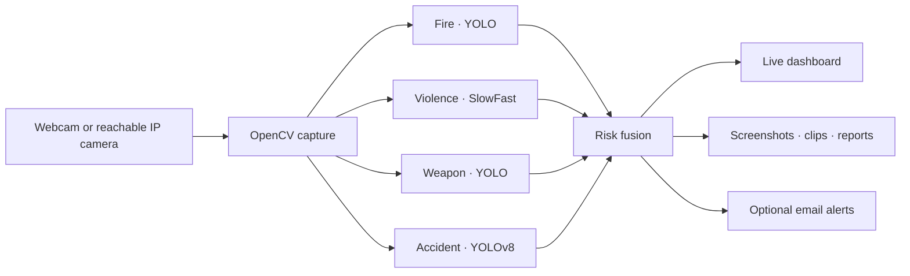
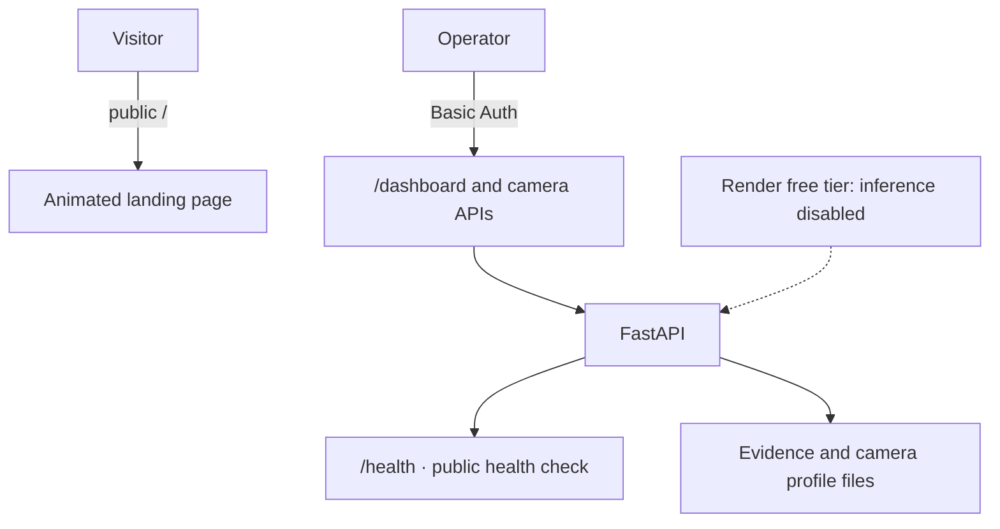

<div align="center">

# NOVAGUARD

### An animated command center for camera-based threat monitoring

[Open the live site](https://novaguard-cctv.onrender.com) · [Open the GitHub repository](https://github.com/Devikrishnakumar/SMART-CCTV-SURVILLENCE)


**Live landing page · animated signal monitor · camera operations behind authentication**

</div>

NovaGuard brings live camera feeds, four detection paths, risk scoring, incident evidence, and email alerts into one monitoring experience.

> **Hosted demo:** the public landing page is available without a login. Dashboard and camera-control routes remain protected. AI inference is disabled on Render's free 512 MB instance to prevent model-loading crashes.

## System Map



## Detection Matrix

| Signal | Model path | Dashboard output |
|:--|:--|:--|
| Fire | Custom YOLO model | Label, confidence, risk |
| Violence | SlowFast video classifier | Action score and status |
| Weapon | Custom YOLO model | Knife or gun detection |
| Accident | YOLOv8 vehicle/person tracking | Collision, traffic, incident state |

## Run Locally

Start the API and detector:

```powershell
python -m pip install -r requirements.txt
python dashboard.py
```

For the animated Vite landing page in a second terminal:

```powershell
cd designpro
npm.cmd ci
npm.cmd run dev
```

Open `http://127.0.0.1:5173` for the landing page or `http://127.0.0.1:5000/dashboard` for the monitor. The Vite page polls service status and the landing visuals animate continuously, respecting reduced-motion preferences.

To serve the built landing page from FastAPI instead, run `npm.cmd run build` inside `designpro`, then start `python dashboard.py` from the project root. The server binds to localhost by default; set `NOVAGUARD_HOST` only when another interface is needed.

## Camera Setup

**Local webcam:** Add camera → Webcam connected to this computer → index `0` (try `1` or `2` if needed). The webcam must be connected to the machine running NovaGuard.

**IP camera or NVR:** add its RTSP/RTSPS/HTTP stream URL. For an authenticated camera, use a dedicated read-only account. Camera profiles are stored in the ignored `cameras.json` file; API responses hide stream credentials. Only one selected feed is processed at a time, and disconnected streams are retried.

```text
rtsp://CAMERA_IP:554/Streaming/Channels/101
```

## Hosted Architecture



The root landing page, `/health`, and static assets are public. Dashboard, video, camera, incident, and report routes require HTTP Basic Auth when deployed. Configure `NOVAGUARD_ACCESS_USERNAME` and `NOVAGUARD_ACCESS_PASSWORD` in the Render service environment.

Render cannot access a webcam attached to your personal computer. Full inference requires a camera stream reachable from Render and a paid instance with enough memory for YOLO and SlowFast. Set `NOVAGUARD_ENABLE_INFERENCE=true` only after upgrading; the free 512 MB instance previously exceeded its memory limit while loading models. Render's filesystem is ephemeral, so incident evidence and camera profiles do not survive restarts without persistent storage.

Email alerts are optional. Set `NOVAGUARD_EMAIL_SENDER`, `NOVAGUARD_EMAIL_PASSWORD`, and any of `NOVAGUARD_FIRE_EMAIL`, `NOVAGUARD_ACCIDENT_EMAIL`, `NOVAGUARD_VIOLENCE_EMAIL`, and `NOVAGUARD_WEAPON_EMAIL`. Use an app password, not an account password.

## Project Map

| Path | Role |
|:--|:--|
| `dashboard.py` | FastAPI routes, camera lifecycle, public landing and health endpoint |
| `detection_engine.py` | Model workers, camera capture, risk fusion |
| `features.py` | Evidence recording, PDFs, optional email alerts |
| `dashboard.html` | Authenticated operations dashboard |
| `designpro/` | Animated React/Vite landing experience |
| `evidence/` | Runtime incident output; not committed |
| `*.pt` | Model weights tracked with Git LFS |
